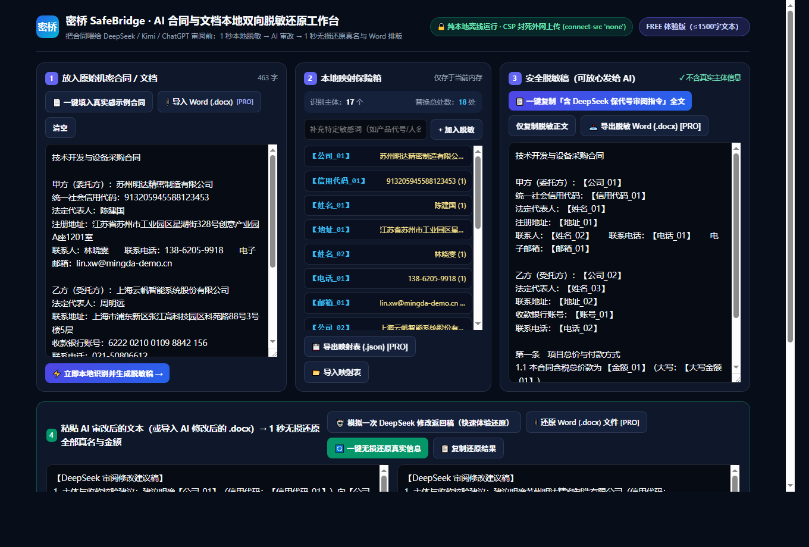
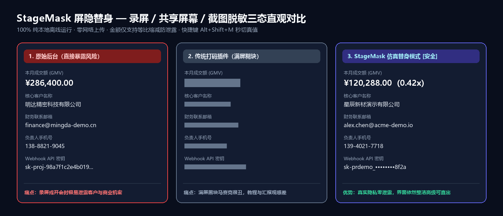

# 棱镜造物 PrismLab — 独立效率软件与本地隐私工具作品集

- **创作者 / 工作室**：棱镜造物 PrismLab
- **面包多官方店铺主页**：[https://mbd.pub/o/prismlab](https://mbd.pub/o/prismlab)（本 GitHub 仓库及在线演示站归属于上述面包多创作者账号）
- **官方作品在线体验总站**：[https://m1manchi2.github.io/prismlab/](https://m1manchi2.github.io/prismlab/)
- **开发理念**：100% 纯本地离线优先（Local-First）· 零数据上传 · 轻量即买即用 · 拒绝臃肿年费订阅

---

## 1. 《密桥 SafeBridge》— AI 合同与文档本地双向脱敏还原工作台（v1.0.0）

> 把机密合同、协议喂给 DeepSeek / Kimi / ChatGPT 审阅前：**1 秒本地脱敏 → AI 审改 → 1 秒无损还原真名与 Word (`.docx`) 原格式**。

- **立即在线免费试用**：[https://m1manchi2.github.io/prismlab/safebridge.html](https://m1manchi2.github.io/prismlab/safebridge.html)
- **离线单文件版下载**：见右侧 [Releases](https://github.com/M1Manchi2/prismlab/releases)（`SafeBridge-v1.0.0-offline.zip`，解压后双击 HTML 断网即可运行）
- **核心特性**：
  - 自动提取中式合同甲乙方公司名、18 位统一社会信用代码（含 GB 32100 校验）、法定代表人/联系人、银行账号、身份证与人民币大小写金额；
  - 一键复制附带“防大模型篡改占位符指令”的审阅全文；
  - 纯前端解析并保留 Word (`.docx`) 段落排版实现原格式脱敏导出与审后还原；
  - 页面内置 `Content-Security-Policy: connect-src 'none'`，物理阻断任何外网数据上传。

---

## 2. 《屏隐替身 StageMask》— 网页录屏截图脱敏与仿真数据替换扩展（v1.0.0）

> 录屏演示、腾讯会议共享屏幕或制作教程截图时，告别满屏丑陋马赛克，一键把敏感信息替换为自然逼真的演示数据。

- **在线交互演示页**：[https://m1manchi2.github.io/prismlab/stagemask.html](https://m1manchi2.github.io/prismlab/stagemask.html)
- **抢先体验安装包**：见右侧 [Releases](https://github.com/M1Manchi2/prismlab/releases)（`StageMask-v1.0.0-edge-chrome.zip`）
- **核心特性**：
  - 支持将手机号、邮箱、身份证、银行卡、API 密钥与自定义客户名一键替换为仿真演示数据，整页同一对象映射一致；
  - 金额仅支持 `0.05×–0.80×` 等比缩减脱敏（底层禁止放大，防范不当用途）；
  - 免费版支持无限次点选/框选高斯模糊、马赛克、黑条遮挡与一键纯净截图；
  - 支持按域名零闪现自动记忆与网页共享屏幕自动防护（Share Shield）。

---

## 合规与隐私承诺

- [隐私政策 (Privacy Policy)](https://m1manchi2.github.io/prismlab/privacy.html)
- [服务条款 (Terms of Service)](https://m1manchi2.github.io/prismlab/terms.html)
